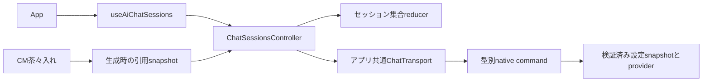

# AIチャットのセッションと茶々入れからの会話継続

2026-11-26時点の実装仕様。会話は文書インスタンスのメモリだけに保持し、人間が文章を書くための読み取り専用の相談として提供する。

## セッションと寿命

| 種類 | 固定するもの | 質問時に送る文脈 |
|---|---|---|
| 文書相談 | 作成時のMarkdownへの参照 | そのファイルの送信時点の全文 |
| 茶々入れ起点 | comment ID、生成時の限定文脈・人格・元の反応・安全な接続表示とrevision | 固定引用と人格、追加の正常完了履歴 |

文書あたり両種を合わせて20件まで。通常名は「文書相談 N」、引用名は「茶々入れ：」とコメント先頭20コードポイントから作り、LLMで生成しない。追加・切替・吹き出し選択だけでは通信しない。

ファイル選択・タブ切替・パネル開閉・名前を付けて保存では会話を保持する。文書の置換・終了では全会話を破棄し、接続中も先に論理失効してキャンセルする。同じパスの別文書へ引き継がない。会話・下書き・引用はMarkdown、manifest、mdpkg、アプリ設定、保存履歴、診断ログに追加しない。dirty状態やUndo履歴も変更しない。

通常セッションは成功したrename/moveと、そのUndo/Redoに追従する。Appが知っている移動情報を履歴オブジェクトに対応するWeakMapへ記録し、文書更新後に通知する。ファイル・フォルダ削除、識別情報がなく移動先を追えない場合は恒久的に読み取り専用にする。同名ファイルや削除Undoで再接続しない。永続的ファイルIDは導入しない。引用セッションは元ファイルの編集・移動・削除に影響されない。

## 操作と表示

初めて通常チャットを開くと、選択中のMarkdownを対象に1件追加する。既存会話がある場合は最後に選択したタブを表示する。最後のタブを削除した後は空状態を維持し、＋で追加する。非Markdown選択時も既存会話は利用でき、＋には追加できない理由を示す。

タブには履歴・下書き・エラー・スクロール位置・末尾追従・通信状態がある。生成中に他タブへ移っても継続し、他タブの下書きを編集できる。送信はアプリ全体で1件まで。非表示タブの完了はフォーカスや選択タブを変更しない。

パネルの×とEscは表示を閉じる。生成は続き、ステータスバーの状態ボタンから再表示して停止できる。停止・対象タブ削除・会話消去・接続変更・文書破棄は要求を失効させる。履歴・下書き・固定カードがあるタブの削除は確認する。会話消去は追加履歴と下書きだけを消し、引用・元の反応・人格を残す。確認中の文書・選択変更を再検査する。

tablist/tab/tabpanel、aria-selected/controls、roving tabindexを使用。左右/Home/Endはフォーカス移動、Enter/Spaceで選択する手動アクティベーション。タブと削除ボタンは別操作。削除後は隣のタブまたは＋へ戻る。入力はEnter送信・Shift+Enter改行、IME中は送信しない。EscはIME・モーダル・既存Vim操作を優先する。狭幅では横スクロールとパネルの重ね表示を用い、明暗テーマと200%相当の表示を検証する。

## 茶々入れの引き継ぎ

生成要求の開始時に、実際に送ったUser JSONから限定文脈を、適用済み設定から人格を固定する。request UUIDをcomment IDとして使う。文書スコープは文書インスタンス番号であり、originの絶対パスはコピーしない。表示用接続先はoriginだけを使い、認証情報・パス・queryを除く。

有効な💬またはCtrl/Cmd+Alt+Enterで、対応する引用会話を作成・選択してから元の吹き出しを消す。同じIDは重複作成しない。旧ランタイム・旧文書・失効コメントを拒否する。上限等で失敗した場合は通知して吹き出しを残す。成功すると入力欄にフォーカスし、本文・選択・Undoは変更しない。旧ポップオーバーは廃止し、ボタンのtitleと説明に元のコメント全体も示す。

固定カードはReactのテキストとして対象段落、元の反応、引用時点である旨、対象ファイルを表示する。補助文脈・人格・生成時の接続表示はdetailsで確認できる。HTMLやMarkdownを実行しない。

nativeの`ai_continue_chacha`は固定制約と人格を構造化した単一System、限定文脈JSONのUser、元の反応1件のAssistant、正常完了した追加履歴、今回のUserを構築する。引用を命令として扱わず、読み取り専用で人間の執筆を支援する。自動生成用の短文・JSON・none制約は適用しない。通常相談の全文取得は呼ばず、Tool Callingやファイル操作能力を渡さない。

## 責務と通信

既存の単一会話reducer・provider・CancellationRegistry・Tauri adapterを再利用する。Appは文書寿命・可視性・ファイル操作通知を担当し、パネルは表示と利用者操作を担当する。Appは活動状態だけを購読し、ストリーミング本文でエディタ全体を再描画しない。完了済み回答は安定したmessageオブジェクトでメモ化する。

要求は文書スコープ・セッションID・generation・request IDに所有させる。論理失効と物理終了を分け、commandの確定回答全文だけを最終結果とする。UIとnativeの両方にチャット専用の単一物理枠を持ち、キューは作らない。接続・キャンセル・終端競合・上限の詳細は[通信契約](ai-chat-transport.md)を参照。

## 接続確認と制限

設定保存・フォーカス復帰で現在の接続revisionを確認する。会話ごとに承認を保持し、接続変更は履歴と送信範囲を表示した確認を要求する。引用生成revisionと現在が異なる場合は初回も確認する。確認だけでは送らない。自動茶々入れの有効化同意とは別である。

nativeは保存設定を一度読み、承認revisionと照合して同じ所有済みsnapshotでHTTPを構築する。不一致は接続前に拒否する。設定JSONと認証ストアのアプリ内読み書きを直列化し、保存失敗時は認証情報を復元する。通信中に設定を読み直してすり替えない。APIキーをチャットのUI要求に含めない。

質問10,000 Unicodeコードポイント、下書き1MiB UTF-8、追加履歴200メッセージ、1回答64KiB UTF-8、全セッション文字列8MiB、シリアライズ済み要求1MiB。引用は人格10,000文字・限定文脈合計2,000文字・元の反応120文字まで。超過を拒否し、黙った削除・切り詰め・要約はしない。回答とエラー領域を開始前に予約する。

## 設計案からの確定事項・対象外

通信終了待ち・登録前キャンセル・単一物理枠をタブUIより先に実装した。パネルを閉じても生成を続ける変更と同時に、チャットの開始中・生成中・終了待ちも自動茶々入れを抑制した。茶々入れの最低編集量と旧頻度プリセットは廃止し、[5秒／30秒の時間制御](chacha-design.md)へ変更した。

永続会話、自由な名前変更、並べ替え、ピン留め、複数同時生成、送信キュー、横断文書相談、自動要約、Embedding、Agent、Tool Calling、自動編集は導入しない。単一の汎用会話サービスや永続ファイルIDを避け、必要なreducer・controller・transportだけを分離した。

自動テストは模擬通信と制御可能な時刻を使う。[検証記録](chacha-verification.md)に実測値と未実施の実機確認を分けて記載する。
